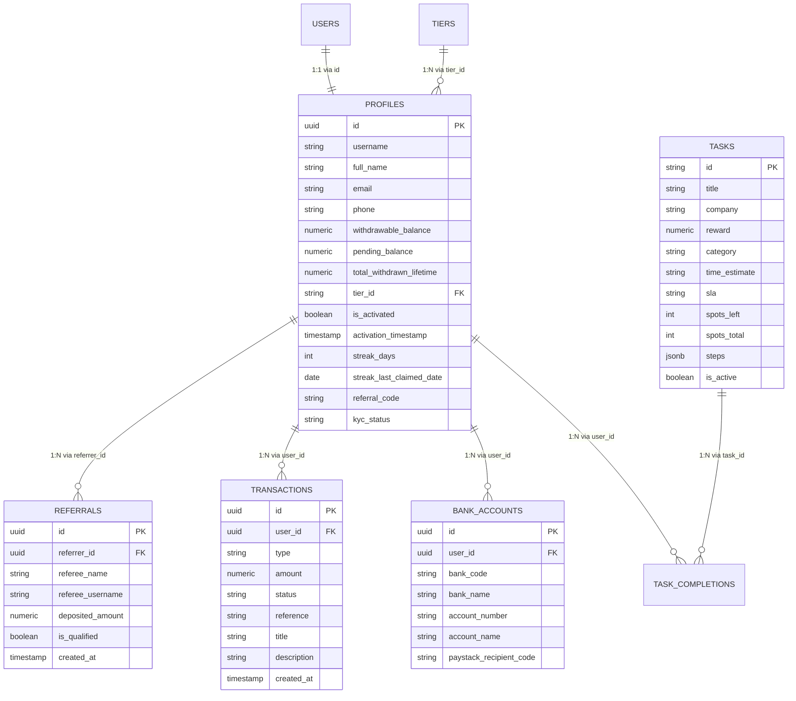

# Supabase Database Synchronization & Relationships Manual

This document details the relational schemas, Row Level Security (RLS) policies, atomic stored procedures (RPCs), and real-time state synchronization in TaskPulse.

---

## 1. Relational Schema Architecture



---

## 2. Stored Procedures (RPCs) & Concurrency Controls

### 1. Daily Login Streak Claim (`claim_daily_reward`)
- **Reward**: ₦450.
- **Timezone**: Evaluated at Nigerian Standard Time (`Africa/Lagos`).
- **Resilience**: If a user misses a day, streak safely wraps to Day 1.
- **Implementation**:
```sql
CREATE OR REPLACE FUNCTION public.claim_daily_reward()
RETURNS JSONB
LANGUAGE plpgsql SECURITY DEFINER SET search_path = public AS $$
DECLARE
    v_uid UUID := auth.uid();
    v_profile public.profiles%ROWTYPE;
    v_today DATE := (NOW() AT TIME ZONE 'Africa/Lagos')::date;
    v_streak INT;
    v_reward CONSTANT NUMERIC := 450;
BEGIN
    IF v_uid IS NULL THEN RAISE EXCEPTION 'not_authenticated'; END IF;

    SELECT * INTO v_profile FROM public.profiles WHERE id = v_uid FOR UPDATE;
    IF NOT FOUND THEN RAISE EXCEPTION 'profile_not_found'; END IF;
    IF NOT v_profile.is_activated THEN RAISE EXCEPTION 'not_activated'; END IF;
    IF v_profile.streak_last_claimed_date = v_today THEN RAISE EXCEPTION 'already_claimed'; END IF;

    v_streak := CASE
        WHEN v_profile.streak_last_claimed_date = v_today - 1 THEN (v_profile.streak_days % 7) + 1
        ELSE 1
    END;

    INSERT INTO public.transactions (user_id, type, amount, status, reference, title, description)
    VALUES (
        v_uid, 'streak_reward', v_reward, 'settled',
        'streak_' || v_uid::text || '_' || v_today::text || '_' || substr(md5(random()::text), 1, 8),
        'Daily Login Reward', 'Day ' || v_streak || ' of your login streak (+₦450)'
    );

    UPDATE public.profiles
       SET withdrawable_balance = withdrawable_balance + v_reward,
           streak_days = v_streak,
           streak_last_claimed_date = v_today
     WHERE id = v_uid;

    RETURN jsonb_build_object(
        'success', true, 
        'streak_days', v_streak,
        'reward_amount', v_reward,
        'new_balance', v_profile.withdrawable_balance + v_reward
    );
END;
$$;
```

### 2. Tier Upgrade (`upgrade_tier_from_wallet`)
- Locks user profile, validates target tier rank > current tier rank.
- Deducts exact tier `stake_amount` from `withdrawable_balance`.
- Updates `tier_id` and sets `has_upgraded_after_limit = TRUE`.
- Writes `'tier_upgrade'` ledger transaction.

---

## 3. Row-Level Security (RLS) Invariants

1. `profiles`: Users can SELECT their own profile; client updates restricted strictly to `full_name`. Balance mutations MUST run through SECURITY DEFINER RPCs.
2. `transactions`: Users can SELECT their own ledger entries. INSERT/UPDATE restricted to SECURITY DEFINER functions and service role.
3. `bank_accounts`: Users can SELECT and INSERT their verified NUBAN accounts.
4. `tasks`: Publicly readable where `is_active = TRUE`. Write access restricted to admin service role.
5. `task_completions`: Authenticated users can INSERT proof screenshots and SELECT their own completions.
