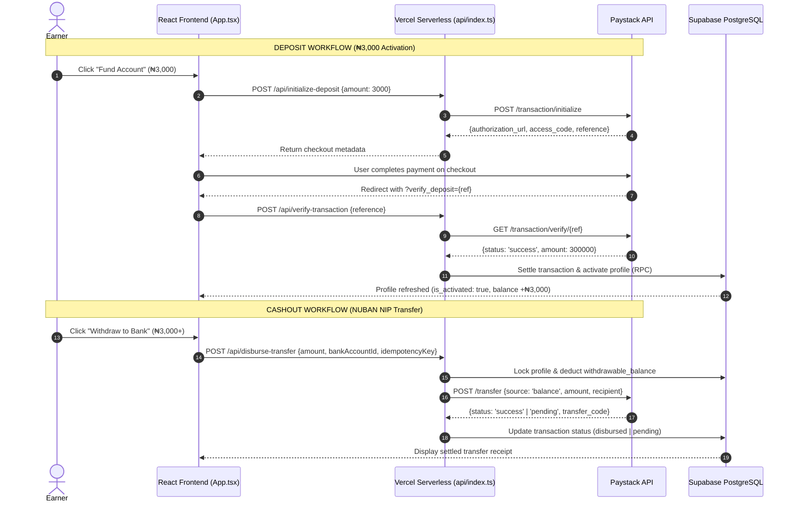

# Paystack & Nigerian Banking Rails Debugging Manual

This document provides in-depth technical procedures for diagnosing and troubleshooting payment flows, banking rails, webhooks, and ledger transactions in TaskPulse.

---

## 1. Paystack API Architecture in TaskPulse



---

## 2. Environment Variables & Gateway Authentication

To execute live transactions, the following secrets must be loaded in the serverless environment:

```env
PAYSTACK_SECRET_KEY=sk_live_... (or sk_test_... in sandbox)
PAYSTACK_PUBLIC_KEY=pk_live_... (or pk_test_... in sandbox)
VITE_PAYSTACK_PUBLIC_KEY=pk_live_...
SUPABASE_SERVICE_ROLE_KEY=eyJhbGciOi... (Used for privileged ledger balance settlement)
```

### Signature Verification for Webhooks
All webhooks sent by Paystack to `/api/paystack-webhook` must be cryptographically verified:
```typescript
const crypto = require('crypto');
const hash = crypto
  .createHmac('sha512', process.env.PAYSTACK_SECRET_KEY)
  .update(JSON.stringify(req.body))
  .digest('hex');

if (hash !== req.headers['x-paystack-signature']) {
  return res.status(401).json({ error: 'Invalid webhook signature' });
}
```

---

## 3. NUBAN Bank Account Resolution & Recipient Codes

TaskPulse supports top Nigerian Commercial Banks and Digital MFBs:
- `50515`: Moniepoint MFB
- `999992`: OPay Digital Services
- `50211`: Kuda Bank
- `044`: Access Bank PLC
- `058`: Guaranty Trust Bank (GTB)
- `057`: Zenith Bank
- `033`: United Bank for Africa (UBA)
- `011`: First Bank of Nigeria

### Diagnostic Steps for Account Resolution:
1. When calling Paystack `/bank/resolve`:
   - Account number must be strictly 10 digits without spaces or hyphens.
   - Bank code must match CBN bank list.
2. Generating Transfer Recipient:
   - Call `/transferrecipient` with type `nuban`, name, account number, bank code, and currency `NGN`.
   - Store the generated `recipient_code` (`RCP_...`) in `public.bank_accounts`.

---

## 4. Double-Spending & Idempotency Safeguards

To prevent double-spending during rapid clicks:
1. **Frontend Disabling**: Disable withdraw/deposit buttons immediately upon submit and display loading spinner.
2. **Idempotency Keys**: Generate a unique key (`idemp_{userId}_{timestamp}_{random}`) transmitted in header `X-Idempotency-Key`.
3. **Database Locks**:
   ```sql
   SELECT * FROM public.profiles WHERE id = v_user_id FOR UPDATE;
   ```
   If balance is insufficient or lock cannot be acquired, reject with HTTP 409 Conflict.
