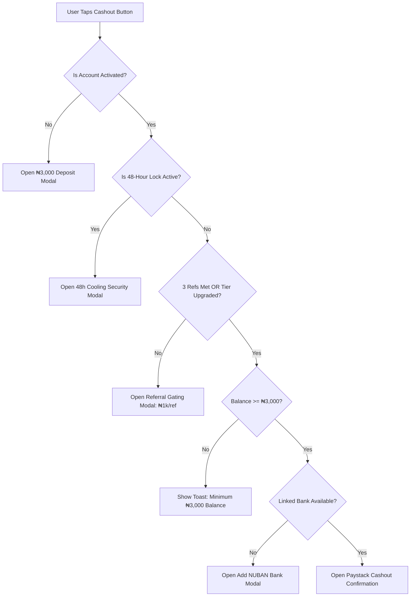

# TaskPulse UI & UX Interaction Guidelines

This document details the interface architecture, accessibility rules, color tokens, and modal state machines for TaskPulse.

---

## 1. 5-Tab Bottom Navigation Hierarchy

The application layout features a persistent, responsive 5-tab bottom navigation bar:

1. **Home (`Compass`)**:
   - High-contrast FinTech wallet hero card displaying available withdrawable balance and pending escrow balance.
   - Quick action pill buttons: Fund (Deposit), Cashout (Withdrawal), Streak (Daily Login), and Tier Upgrade.
   - Live activity and referral milestone indicators.
2. **Tasks (`CheckSquare`)**:
   - Active task in progress workspace (with real-time countdown timer and proof screenshot attachment).
   - Real production tasks catalog (exclusively Growth Referral Task at ₦1,000/ref).
   - Live rolling 24-hour countdown card ("More Tasks Dropping Daily").
3. **Withdraw (`Wallet`)**:
   - Dedicated Cashout Dashboard.
   - Prominent, high-contrast **"Add Bank Account (NUBAN)"** card and button with live Paystack account name resolution.
   - 3-step transparent qualification checklist (48h Cooling Seasoning, 3 Qualified Referrals or Tier Upgrade, and ₦3,000 Minimum Floor).
   - Primary cashout action button.
4. **History (`History`)**:
   - Filterable ledger records (`All`, `Finance`, `Tasks`, `Referrals`, `Rewards`).
   - Detailed digital transfer receipt modal with transaction reference, timestamp, channel, and settlement state.
5. **Profile (`User`)**:
   - Identity verification level, BVN/NIN KYC review submission modal, legal policies, and logout.

---

## 2. Withdrawal Qualification Gating UX

The cashout button behavior is deterministic across all screens:

---

## 3. Dark Mode & High-Contrast Typography

- **Dark Mode Background**: `#0c0d12` (Deep Obsidian / Zinc).
- **Cards**: `bg-white dark:bg-[#111218]` with subtle border `dark:border-white/[0.08]`.
- **Primary Accents**:
  - Emerald / Cyan: Successful actions, balances, active buttons (`from-emerald-500 via-teal-500 to-cyan-500`).
  - Indigo / Blue: Referral badges, share link actions (`from-indigo-500 to-blue-600`).
  - Amber: Security cooling locks, escrowed funds, warnings (`from-amber-500 to-orange-500`).
- **Typography**: Inter / Outfit fonts, legible small tags with minimum font size `text-[9px]` or `text-[10px]` with font-weight `font-bold` or `font-black`.

---

## 4. Toast Notifications & Confetti Trigger

- Toasts automatically dismiss after 4,000ms.
- Confetti triggers upon payment verification, referral link copying, and daily reward claims.
