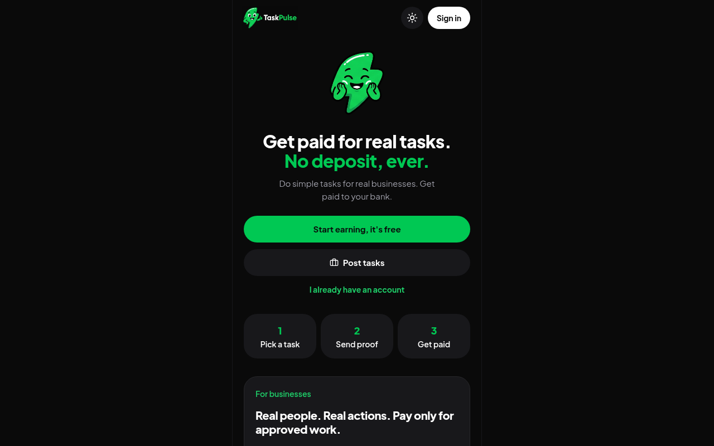
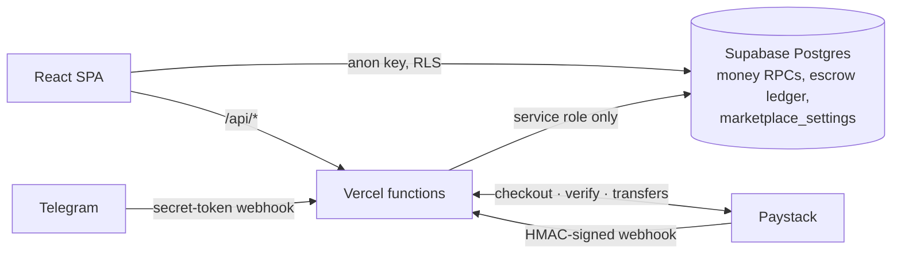

<p align="center">
  
</p>

# TaskPulse

**A free-to-join micro-task marketplace for Nigeria. Businesses fund small tasks, workers complete them, and approved work is paid out to Nigerian bank accounts through Paystack, with every money rule enforced inside Postgres.**

**Get paid for real tasks. No deposit, ever.**

**Live:** https://taskpulse-two-beta.vercel.app · custom domain: https://taskpulse.website



---

## The problem

A micro-task marketplace only works if workers trust that they'll be paid and businesses trust that they're paying for real work. TaskPulse is built around that. Joining is free for workers, with no activation deposit. Businesses pre-fund every task into escrow, so every task a worker sees is already paid for, and the reward moves to the worker only when the business approves the work.

TaskPulse began with an activation-deposit model. Migration `008_free_marketplace.sql` turned it into this free-to-join marketplace without touching any existing user's balance, and wrote a one-time snapshot of every balance to `legacy_balance_snapshots` for audit.

## Key features

- **Worker flow**: browse funded tasks, submit proof (screenshot, link or text), get approved, and withdraw to a verified NUBAN bank account.
- **Business flow**: create a campaign, pay through Paystack checkout, review submissions (approve or reject with a note), and pause, resume or cancel with automatic refund accounting for unused slots.
- **Anti-fraud withdrawal rules**: a minimum and a daily limit, a cap on withdrawals per day, a first-withdrawal cooldown, and one bank account per user.
- **Referral bonuses** that pay out only once the platform fee earned from the referred friend covers them, with a cap per referrer.
- **Daily check-in streaks** (no cash) and celebration animations.
- **Telegram bot** (@Taskpulse101bot) for discovering tasks, with deep-link referrals.
- **Installable web app** (web manifest and icons), with light and dark themes.

## How it works

### For workers

1. **Sign up for free.** There is no activation fee and no deposit.
2. **Pick a task** from the Tasks tab. Every task you see has already been paid for by the business that posted it.
3. **Submit proof**: a screenshot, a link, or a text answer, depending on the task.
4. **Get paid when it's approved.** The reward moves from the campaign's escrow into your withdrawable balance in one atomic database transaction.
5. **Withdraw** to your verified Nigerian bank account through Paystack.

Withdrawal rules (anti-fraud):

| Rule | Default |
| --- | --- |
| Minimum withdrawal | ₦1,000 (whole Naira) |
| Daily withdrawal limit | ₦20,000, at most 2 withdrawals per day (Africa/Lagos day) |
| First-withdrawal cooldown | 48 hours after your first approved task |
| Bank accounts | One verified NUBAN account per user; an account cannot be linked to two users |

### Referral bonus

Invite a friend with your link. When they have **3 tasks approved by
businesses other than you**, you get **₦200** (the friend's own bonus is ₦0 by
default; `referral_bonus_referee`). To stop bonus farming, the bonus is only
paid once the platform fee earned from the friend's approved tasks covers it
(`referral_require_fee_cover`): at ₦267+ per task that is exactly 3 tasks; on
cheaper tasks it takes more. Bonuses are capped per referrer (50 by default).
Nobody pays to join, so referrals never involve deposits.

### Daily check-in

Checking in daily builds your streak badge. It does not pay cash.

### For businesses

1. Sign up as a business (or switch from Profile → "Open business account").
2. Create a campaign: title, instructions, category, reward per completion, number of slots, proof type (screenshot / text / link) and an optional link.
3. Pay through Paystack. **Total = reward × slots × 1.25** (reward budget plus a 25% platform fee **on top**), fee rounded up to the nearest Naira. The worker always receives the full reward. Example: 100 responses × ₦300 = ₦30,000 + ₦7,500 fee = **₦37,500** (₦375 per approved response).
4. Your task goes live as soon as the payment is verified.
5. Review submissions in the Business tab. **Approve** pays the worker from your campaign escrow. **Reject** (with a note) frees the slot for someone else.
6. Pause, resume or cancel at any time. Cancelling records a refund for the unused slots: their rewards **and their share of the 25% fee** (`refund_fee_on_unused`). Submissions still awaiting review keep their reward reserved; rejecting them after cancelling adds to the refund. Payments that arrive for an already-funded or deleted campaign, and underpayments, are listed for a full refund. Refunds are issued by the owner from the Paystack dashboard and recorded with `record_campaign_refund()` / `record_payment_refund()`; `admin_refunds_owed()` lists everything owed.

Admins (`profiles.role = 'admin'`) can review any submission.

---

## Configuration

Every money rule lives in **one row** of `public.marketplace_settings` and is
enforced inside Postgres functions, so the browser can't bypass it:

| Column | Default |
| --- | --- |
| `min_withdrawal` | 1000 |
| `daily_withdrawal_limit` | 20000 |
| `max_withdrawals_per_day` | 2 |
| `payout_cooldown_hours` | 48 |
| `referral_bonus_referrer` / `referral_bonus_referee` | 200 / 0 (009) |
| `referral_require_fee_cover` | true (009) |
| `refund_fee_on_unused` | true (009) |
| `referral_qualifying_tasks` | 3 |
| `referral_max_bonuses_per_referrer` | 50 |
| `platform_fee_rate` | 0.25 |
| `min_reward_per_task` / `max_reward_per_task` | 50 / 5000 |
| `min_campaign_slots` / `max_campaign_slots` | 5 / 10000 |

The frontend reads this row on start-up and falls back to
`src/config/marketplace.ts` (keep both in sync).

---

## Tech stack

| Layer | Tools |
| --- | --- |
| Frontend | React 19, TypeScript, Vite, Tailwind CSS v4, Motion, Lucide icons, Vercel Analytics |
| API | Vercel serverless functions (`api/*.ts`, Node 22) |
| Database & auth | Supabase (Postgres, Auth, RLS, `SECURITY DEFINER` RPCs) |
| Payments | Paystack (checkout, verification, webhooks, NUBAN resolution, transfers) |
| Messaging | Telegram Bot API (plain `fetch`) |
| Tests | `tsx` test scripts, plus SQL regression tests run on local Postgres |

## Architecture



- **Frontend**: React 19 + TypeScript + Vite + Tailwind CSS v4 (`src/`).
  - `src/App.tsx`: shell, routing between tabs, session and Paystack callback handling.
  - `src/components/`: Landing, Auth, Home, Tasks, Wallet, Profile, Business.
  - `src/lib/supabaseClient.ts`, `src/lib/marketplace.ts`, `src/lib/api.ts`: data access.
- **Serverless API** (Vercel, `api/`):
  - `initialize-deposit.ts`: starts Paystack checkout for a **campaign** (`{ campaignId }`). The amount is computed by the database. Plain user deposits are rejected (HTTP 410).
  - `verify-transaction.ts`: verifies a Paystack reference and settles the campaign (or a legacy in-flight deposit).
  - `paystack-webhook.ts`: HMAC-verified `charge.success` / transfer events.
  - `resolve-account.ts`, `link-bank.ts`: NUBAN verification and the one-bank rule.
  - `disburse-transfer.ts`: withdrawals via Paystack transfers (rules enforced by `request_cashout()`).
  - `telegram-webhook.ts`: the @Taskpulse101bot Telegram bot, a read-only task listing (see `docs/TELEGRAM-BOT.md`).
  - `keep-alive.ts`, `check-db.ts`: health and keep-alive endpoints.
- **Database**: Supabase Postgres with RLS. Money functions are `SECURITY DEFINER`; settlement, cashout and bank-saving RPCs are callable only by the service role (via `api/`), and clients cannot write balances, completions or bank rows directly.
  - Key tables: `profiles`, `tasks`, `task_completions`, `transactions`, `bank_accounts`, `referrals`, `campaigns`, `campaign_payments`, `campaign_ledger`, `marketplace_settings`.

### Migrations

Run in order: `supabase/schema.sql`, then `002` to `009` (or use `supabase/migrations/` with `supabase db push`, but don't do both).
`008_free_marketplace.sql` is the free-marketplace pivot. It runs in one transaction and can safely be run again. `009_business_payments.sql` adds campaign refunds and payment hardening.

## Notable engineering decisions

Each item below is backed by code in this repo.

- **Money is stored as `NUMERIC(14,2)`, with `CHECK` constraints.** For example, balances can't go negative and amounts must be positive (`supabase/migrations/20261013000001_initial_schema.sql`).
- **Money rules live in the database, not the browser.** One `marketplace_settings` row drives every limit. It is enforced in `SECURITY DEFINER` functions that only the service role can call, so clients can't write balances, completions or bank rows directly.
- **Row-level security** is enabled on all user-facing tables, and later migrations closed anonymous read access to campaign and payment tables.
- **Concurrency safety.** Settlement, approval and refund functions lock the rows they change (`SELECT … FOR UPDATE`) before moving money, so two concurrent approvals or webhooks can't double-pay.
- **Escrow accounting.** A `campaign_ledger` records funding, payouts and refunds, and `campaign_ledger_check()` lets admins reconcile it.
- **Verified webhooks.** The Paystack webhook checks an HMAC-SHA512 signature. The Telegram webhook requires a secret token header and has a per-chat rate limit.
- **A safe business-model pivot.** The 008 migration runs in a single transaction, can safely be run again, and preserves every existing balance.
- **Recovery tooling.** `scripts/reconcile-pending.ts` checks stuck "pending" payments against Paystack. It does a dry run by default and changes nothing without `--apply`. The incident that motivated it is written up in `docs/RUNBOOK-pending-payments.md`.

---

## Local development

```bash
npm install
cp .env.example .env.local   # fill in Supabase + Paystack TEST keys
npm run dev                   # http://localhost:3000
npm run lint                  # tsc --noEmit
npm run build
```

Environment variables:

| Variable | Where | Purpose |
| --- | --- | --- |
| `VITE_SUPABASE_URL`, `VITE_SUPABASE_ANON_KEY` | Browser + API | Supabase project |
| `VITE_PAYSTACK_PUBLIC_KEY` | Browser | Paystack public key |
| `SUPABASE_SERVICE_ROLE_KEY` | API only (required) | Settlement, withdrawals, bank linking |
| `PAYSTACK_SECRET_KEY` | API only | Checkout, verification, transfers, webhook signature |
| `APP_URL` | API | Paystack callback base URL (e.g. `https://taskpulse.website`) |
| `TELEGRAM_BOT_TOKEN`, `TELEGRAM_WEBHOOK_SECRET`, `TELEGRAM_BOT_USERNAME` (optional) | API only | Telegram bot (see `docs/TELEGRAM-BOT.md`) |

Use Paystack **test** keys locally. Never put the service role key or Paystack secret key in a `VITE_` variable.

## Tests

```bash
npm run test:pricing    # campaign pricing, fee, refund and referral-copy maths
npm run test:telegram   # Telegram webhook against a mocked Bot API + PostgREST
npm run test:sql        # money-function regression suite on a throwaway LOCAL Postgres (refuses non-local hosts)
npm run test:api        # webhook + verify-transaction against local PostgREST and a mock Paystack (needs SERVICE_JWT)
npm run lint            # TypeScript type-check
```

`test:sql` and `test:api` need local infrastructure and are built to refuse to run against production.

## Project history

64 commits since October 2026 (from `git log`).

---

**Role:** built by **Sanni-Musa Emmanuel George**, full-stack developer and designer, Lagos.
[github.com/geosan11](https://github.com/geosan11) · [linkedin.com/in/george-sanni-musa-92b699195](https://www.linkedin.com/in/george-sanni-musa-92b699195)
